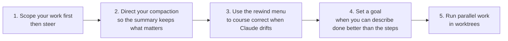
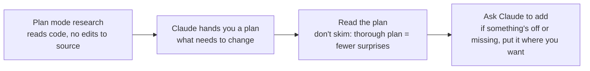
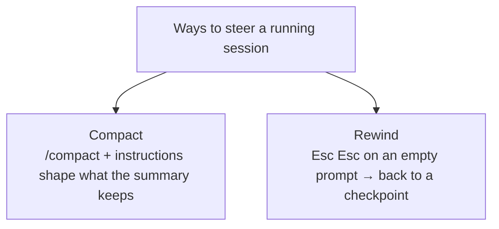

# Claude Code in action — notes

Course: [Claude Academy](https://academy.claude.com/courses/claude-code-in-action) · Day 4 (optional) · Quiz: see [colleague-tips](../colleague-tips.md) Shared resources.

## Lesson 1: Steering long sessions

### Putting it together

### 1. Scope the work first with plan mode

### 2–3. Steer while Claude works

- Compact: e.g. `/compact keep the failing test name, the plan and decisions; drop exploration`.
- Rewind: restores code and conversation; use it when Claude drifts instead of arguing it back.

### 4. Let Claude run more autonomously: goal vs loop

| Goal (`/goal`) | Loop (`/loop`) |
|---|---|
| Sets a completion condition: what done looks like | Runs a prompt on an interval between turns |
| Keeps working across turns until a fast evaluator confirms it | Interval is fixed or self-paced |
| Evaluator only reads the transcript (so make results visible: run tests, print output) | Use it to poll something external: CI run, deploy |
| Cancel: `/goal clear` | Cancel: self-paced → Esc; fixed → ask Claude to cancel, or it expires after 7 days |

Both: let Claude run more autonomously. Rule of thumb: goal = "until X is true", loop = "every N, check Y".

### 5. Same files vs its own file tree

| Sessions on the same files | Worktrees |
|---|---|
| Two steering wheels in one car: unsafe | Each session gets its own independent file tree |
| Two Claude sessions fight over the same files | Agents can't clobber each other's changes |
| Leads to conflicts | A clean worktree is removed when the session exits |

Both: multiple agents on the same codebase. Parallel work → always worktrees (Day 6).

### Take-away
- Plan first, read the plan, then let it run.
- Long session: `/compact <what to keep>`; drift: Esc Esc rewind.
- `/goal` when done is clear; `/loop` to watch external things.
- Parallel = worktrees, never two sessions on one checkout.
